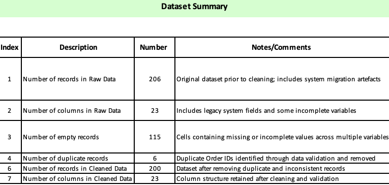
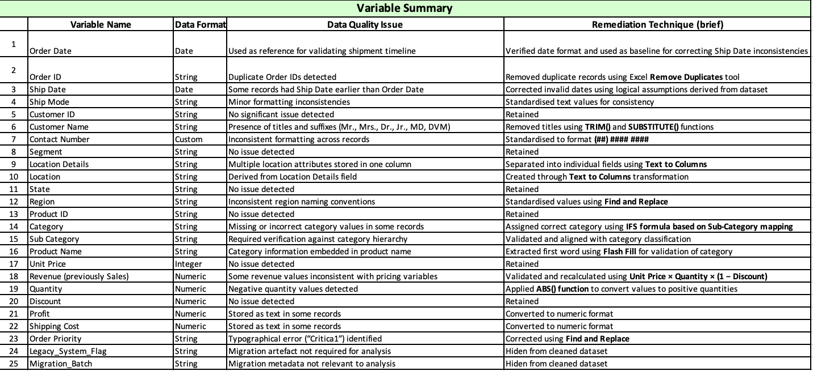
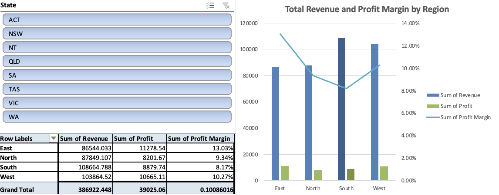
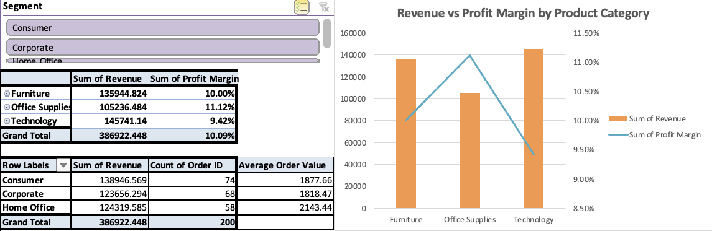
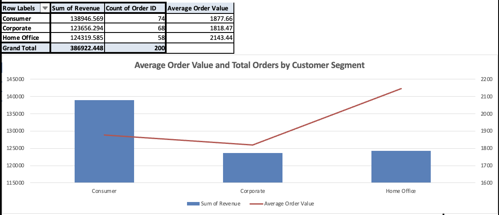

# Apex Global Solutions: Data Remediation & 2026 Expansion Analysis

**Fixing a retail dataset broken by a system migration, then using it to answer the COO's expansion questions.**

[Overview](#overview) · [Data cleansing](#data-cleansing) · [Key insight](#key-insight) · [Recommendations](#recommendations) · [Reflection](#reflection)

---

## Overview

After Apex Global Solutions (AGS) ran a **System Consolidation Initiative**, its merged sales dataset came out with serious data-integrity problems. The COO asked for two things:

1. **A clean, verified dataset** that can be trusted for reporting.
2. **Answers to three analytical questions**, plus recommendations for the **2026 Strategic Expansion Framework**.

I cleaned and validated the dataset end-to-end in Excel, then built the revenue and margin analysis behind the expansion recommendations.

| | Raw data | Cleaned data |
|---|---:|---:|
| Records | 206 | **200** |
| Duplicate records | 6 | 0 |
| Records with missing or incomplete values | 115 | 0 |

> [!NOTE]
> This project was completed for MIS271 (Deakin University, T1 2026). AGS is a fictional company and the dataset was supplied for the assessment.

## Data cleansing

The raw file had eight categories of "data rot." Each one was fixed with a specific Excel technique, and every fix was checked against business logic, not just made to look tidy.

| # | Issue | Fix |
|---|---|---|
| 1 | **Missing categories:** blank `Category` and `Sub-Category` values | Used Flash Fill to pull the sub-category from the first word of `Product Name`, then an `IFS` formula to map each sub-category to its category |
| 2 | **Ship dates before order dates** | Recalculated `Ship Date` as `Order Date` + 5 days (the average shipping period) |
| 3 | **Negative quantities** | Converted with `ABS()`. Unit guidance confirmed these were data-entry errors, not returns |
| 4 | **Inconsistent region labels** | Standardised with Find & Replace |
| 5 | **Inconsistent contact numbers and numbers stored as text** | Converted to Number format. Phone numbers reformatted to `(##) #### ####` |
| 6 | **Titles and suffixes in customer names** (Mr., Dr., Jr., MD, DVM…) | Removed with `SUBSTITUTE()` and `TRIM()` |
| 7 | **Exact duplicate rows, blank columns, and mixed fields** | Removed duplicates and blank columns. Split `Store Details` with Text to Columns. Fixed the `"Critica1"` typo in `Order Priority` |
| 8 | **Unreliable stored revenue** | Recalculated as `Unit Price × Quantity × (1 − Discount)`. Shipping cost was left out because it is an operating expense, not sales income |

> [!IMPORTANT]
> Revenue was treated as a **derived field**. It was rebuilt from its inputs rather than trusted as stored, so the verified total (**$386,922.45**) reflects the corrected quantities and prices.

Full variable-level summary

## Answers to the COO

| Question | Answer |
|---|---|
| Verified grand total revenue | **$386,922.45** |
| Highest-revenue region | **South:** $108,664.79 |
| Lowest-revenue product category | **Office Supplies:** $105,236.48 |

## Key insight

**Revenue leaders aren't margin leaders.** The same pattern shows up in three places: the highest-volume option is not the highest-value one.

| Dimension | Volume leader | Value leader |
|---|---|---|
| Region | South: $108.7K revenue, 8.17% margin | **West:** $103.9K revenue, **10.27% margin** |
| Product category | Technology: $145.7K revenue, 9.42% margin | **Office Supplies:** lowest revenue, **11.12% margin** (highest) |
| Customer segment | Consumer: 74 orders, $1,878 AOV | **Home Office:** fewest orders (58), **$2,143 AOV** (14% above Consumer) |

  

  

  

## Recommendations

1. **Prioritise the West region for expansion investment.** Its revenue is close to the South's, but its margin is about 2 points higher. Marketing spend, inventory, and logistics should go where demand and returns are both strong.
2. **Scale Office Supplies through marketing and placement.** It earns the most margin per dollar of any category but is underweighted in sales. Each extra dollar of Office Supplies revenue adds more profit than the same growth in Technology or Furniture.
3. **Build targeted campaigns for the Home Office segment.** It has the highest order value and the fewest orders. Bundled offers, loyalty incentives, and outreach around remote work could raise order frequency without large-scale customer acquisition.

## Tools

- **Excel:** Find & Replace, `IFS`, `ABS()`, `TRIM()`/`SUBSTITUTE()`, Flash Fill, Text to Columns, Remove Duplicates, PivotTables and PivotCharts
- **Chart.js:** visualisation

## Reflection

The ship-date and negative-quantity fixes taught me to question the "obvious" fix. At first glance the negative quantities looked like returns. Unit guidance confirmed they were data-entry errors, and assuming otherwise would have changed the revenue validation. Since then, I check every remediation decision against the actual business logic, not the one that is statistically convenient.

---

Built by **Lynn Le** · Bachelor of Business Analytics, Deakin University

